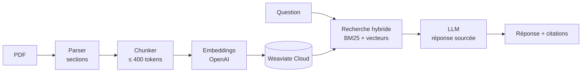

# RAG scientifique

Un assistant qui répond à des questions sur des articles scientifiques, en s'appuyant uniquement sur leur contenu et en **citant ses sources** (section et page).

Le projet couvre toute la chaîne d'un système RAG (*Retrieval-Augmented Generation*) : extraction du texte des PDF, découpage en chunks, indexation dans une base vectorielle, recherche hybride, génération de la réponse et évaluation sur un benchmark.

🔗 **Démo en ligne** : *(lien à ajouter après le déploiement)*

---

## Exemple

> **Question** : Quel matériel a servi à l'entraînement du Transformer ?
>
> **Réponse** : Le modèle a été entraîné sur une machine équipée de 8 GPU NVIDIA P100 *(5.2 Hardware and Schedule, p. 7)*.

Les questions peuvent être posées en français, même si les articles sont en anglais : la recherche par le sens (embeddings) fait le lien entre les deux langues.

---

## Architecture



| Étape | Fichier | Rôle |
|---|---|---|
| Parsing | `PDF.py` | Extrait le texte avec PyMuPDF et le découpe en sections, à partir des titres en gras |
| Chunking | `chunking.py` | Découpe chaque section en chunks de 400 tokens maximum |
| Indexation | `indexer.py` | Calcule les embeddings et insère les chunks dans Weaviate |
| Recherche | `search.py` | Recherche hybride : mots-clés (BM25) + similarité vectorielle |
| Génération | `answer.py` | Envoie la question et les meilleurs chunks au LLM, qui rédige une réponse sourcée |
| Interface | `app.py` | Application Streamlit |
| Évaluation | `Benchmarks/benchmark.py` | Fait tourner le RAG sur le benchmark et l'évalue avec Ragas |

---

## Choix techniques

**Chunking par section.** Les articles scientifiques sont structurés en sections. Chaque section est découpée séparément, pour qu'un chunk ne mélange jamais deux sujets. Une section courte donne un seul chunk. Une section longue est découpée par paragraphes, puis par phrases si un paragraphe dépasse la limite, avec un chevauchement de 50 tokens entre deux chunks consécutifs. La taille est mesurée en tokens avec `tiktoken`, le tokenizer des modèles OpenAI.

**Titre de section dans l'embedding.** Le texte vectorisé est précédé du titre de sa section. Un passage qui ne mentionne pas explicitement son sujet est ainsi mieux retrouvé.

**Sections exclues.** Les références bibliographiques et les remerciements ne sont pas indexés : riches en mots-clés mais pauvres en contenu, ils pollueraient les résultats.

**Identifiants déterministes.** Chaque document est identifié par le hash SHA-256 de son contenu, et chaque chunk par `pdf_id:section_id:chunk_index`, converti en UUID. Réindexer un document remplace ses chunks au lieu de les dupliquer, et un fichier renommé ou déplacé garde le même identifiant.

**Réindexation complète par document.** Avant d'indexer un PDF, tous ses anciens chunks sont supprimés. Si le découpage change, aucun chunk obsolète ne reste dans la base.

**Recherche hybride.** La recherche par mots-clés (BM25) est précise sur les termes techniques (« BLEU », « multi-head attention »), la recherche vectorielle comprend le sens et les reformulations, y compris d'une langue à l'autre. Les deux sont combinées avec un poids `alpha = 0.5`.

**Réponses sourcées et sans invention.** Le LLM reçoit des consignes strictes : répondre uniquement à partir des extraits fournis, citer la section et la page de chaque information, et dire qu'il ne sait pas si la réponse n'y figure pas.

---

## Stack

- **Python 3.10+**
- **PyMuPDF** : extraction du texte des PDF
- **tiktoken** : comptage des tokens
- **OpenAI** : embeddings (`text-embedding-3-small`) et génération de la réponse
- **Weaviate Cloud** : base vectorielle, recherche hybride
- **Streamlit** : interface
- **Ragas** : évaluation

---

## Installation

```bash
git clone https://github.com/RomainDevos/RAG_scientific.git
cd RAG_scientific
python -m venv venv
venv\Scripts\activate          # Windows
# source venv/bin/activate     # macOS / Linux
pip install -r requirements.txt
```

Crée un fichier `.env` à la racine du projet :

```dotenv
OPENAI_API_KEY=...
WEAVIATE_URL=https://...weaviate.cloud
WEAVIATE_API_KEY=...
```

Il faut un compte OpenAI avec une clé API, et un cluster [Weaviate Cloud](https://console.weaviate.cloud) (une offre gratuite existe).

---

## Utilisation

**1. Indexer les articles** : les PDF ne sont pas versionnés (fichiers ignorés par Git). Crée un dossier `PDF/` et place-y les trois articles du benchmark (*Attention Is All You Need*, *Retrieval-Augmented Generation for Knowledge-Intensive NLP Tasks*, *End-to-End Object Detection with Transformers*), nommés `Attention_is_all_you_need.pdf`, `RAG.pdf` et `DETR.pdf`. Puis :

```bash
python indexer.py
```

**2. Poser une question** en ligne de commande, ou lancer l'interface :

```bash
python answer.py
python -m streamlit run app.py
```

---

## Évaluation

Le système est évalué sur un benchmark de **28 questions** rédigées à partir des articles du corpus, chacune avec sa réponse de référence et la section où elle se trouve :

| Article | Questions |
|---|---|
| *Attention Is All You Need* (Vaswani et al., 2017) | 11 |
| *Retrieval-Augmented Generation for Knowledge-Intensive NLP Tasks* (Lewis et al., 2020) | 7 |
| *End-to-End Object Detection with Transformers* (Carion et al., 2020) | 10 |

Les questions mélangent architecture, entraînement et résultats. Certaines ont un équivalent dans plusieurs articles (matériel, optimiseur, jeux de données) : elles vérifient que la recherche ne confond pas les sources.

Trois métriques [Ragas](https://docs.ragas.io) sont calculées, avec un LLM comme juge :

- **Context recall** : les chunks retrouvés contiennent-ils l'information nécessaire ?
- **Faithfulness** : la réponse s'appuie-t-elle uniquement sur les chunks retrouvés ?
- **Factual correctness** : la réponse est-elle juste par rapport à la référence ?

```bash
pip install ragas
python -m Benchmarks.benchmark
```

### Résultats

Première mesure (28 questions, un seul passage, LLM juge `gpt-6-luna`) :

| Configuration | Context recall | Faithfulness | Factual correctness |
|---|---|---|---|
| Hybride, `alpha = 0.5`, top 3 | 0,37 | 0,94 | 0,26 |

**Lecture.** La fidélité est élevée : quand le système répond, il s'appuie sur les extraits retrouvés. Le point faible est la **recherche** : seulement 37 % de l'information nécessaire figure dans les 3 chunks retrouvés, ce qui limite l'exactitude des réponses (0,26). Les pistes ci-dessous visent donc d'abord le retrieval (titres de sections, nombre de chunks, filtre par document).

*À compléter : comparaison de plusieurs réglages (BM25 seul, vecteurs seuls, `alpha`, top-k) pour mesurer l'effet de chaque amélioration.*

---

## Limites connues

- **Détection des sections** : elle repose sur les titres en gras. Elle fonctionne bien sur les articles testés, mais peut échouer sur d'autres mises en page.
- **Chunks très courts** : une section d'une seule phrase donne un chunk minuscule, qui peut remonter dans les résultats sans apporter d'information.
- **Tableaux et équations** : PyMuPDF les extrait mal, leur contenu est donc peu exploitable.
- **Découpage en phrases** : il est naïf et peut se tromper sur des abréviations comme « et al. » ou « e.g. ».
- **Pas de filtre par document** : une question ne peut pas encore être limitée à un article précis.

## Pistes d'amélioration

- Regrouper les sections trop courtes avec la suivante
- Afficher les sources sous chaque réponse dans l'interface
- Ajouter un filtre par article dans la recherche
- Ajuster la taille des chunks et le poids `alpha` à partir des résultats du benchmark